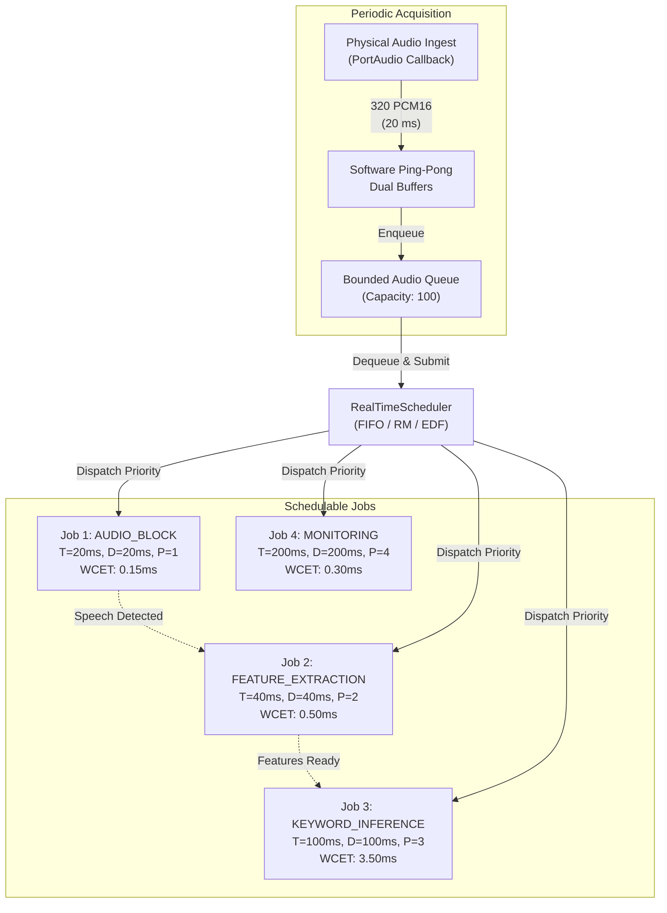

# STAGE 7 REPORT: APPLICATION-LEVEL REAL-TIME SCHEDULING

**Project:** Real-Time Adaptive Voice Recognition Using Python: Deadline-Aware Scheduling, Ping-Pong Buffering, and Adaptive Audio Processing  
**Document:** `results/stage7_realtime_scheduling_report.md`  
**Execution Date:** 2026-11-04  
**Status:** COMPLETED & VERIFIED (STOPPING BEFORE ADAPTIVE CONTROL)  
**Environment:** Windows 11 x64, Python 3.12.10, PyTorch 2.15.0+cpu (10 worker threads), SoundDevice / PortAudio  
**Artifacts Generated:**  
- Engine Source: [`src/rts/tasks.py`](file:///c:/Users/golu6/Desktop/RTOS_SHUBHAM/src/rts/tasks.py), [`src/rts/scheduler.py`](file:///c:/Users/golu6/Desktop/RTOS_SHUBHAM/src/rts/scheduler.py), [`src/rts/monitor.py`](file:///c:/Users/golu6/Desktop/RTOS_SHUBHAM/src/rts/monitor.py)
- Pipeline Binding: [`src/application/scheduled_recognizer.py`](file:///c:/Users/golu6/Desktop/RTOS_SHUBHAM/src/application/scheduled_recognizer.py)
- Unit & Integration Tests: [`tests/test_rts.py`](file:///c:/Users/golu6/Desktop/RTOS_SHUBHAM/tests/test_rts.py) (11 tests, all passing)
- Comprehensive Results: [`results/realtime_scheduling_results.json`](file:///c:/Users/golu6/Desktop/RTOS_SHUBHAM/results/realtime_scheduling_results.json)

---

## 1. Executive Summary & Acceptance Criteria Checklist

Stage 7 implements, benchmarks, and integrates an application-level real-time task scheduling subsystem into the live keyword recognition pipeline. The system provides three pluggable scheduling policies:
1. **Baseline (FIFO):** Standard arrival-order dispatching without priority or deadline awareness.
2. **Rate Monotonic (RM):** Static fixed-priority scheduling derived from task periods ($T_i$).
3. **Earliest Deadline First (EDF):** Dynamic priority scheduling derived from absolute deadlines ($d_i = r_i + D_i$).

The scheduler actively governs the execution sequence of all computational tasks in the system: audio block ingest, framing/VAD, Log-Mel spectrogram extraction, deep learning inference, and periodic system telemetry.

### Acceptance Criteria Verification Table

| Acceptance Criterion | Verification Method & Implementation Reference | Measured Result | Status |
| :--- | :--- | :--- | :---: |
| **1. Baseline, RM, and EDF implemented** | Implemented in [`src/rts/scheduler.py`](file:///c:/Users/golu6/Desktop/RTOS_SHUBHAM/src/rts/scheduler.py) via `SchedulingPolicy` enum and explicit policy comparison sorting keys. | Verified across unit tests and full pipeline benchmarks | **PASS** |
| **2. Scheduling decisions recorded** | Audited in `RealTimeScheduler._decision_history` via `SchedulingDecision` dataclass capturing timestamp, policy, chosen job, queue size, and contending jobs. | Over 836 decisions logged per run, 131 in live mic test | **PASS** |
| **3. Both policies pass synthetic ordering tests** | Tested in [`tests/test_rts.py`](file:///c:/Users/golu6/Desktop/RTOS_SHUBHAM/tests/test_rts.py) (`test_rate_monotonic_priority_ordering`, `test_earliest_deadline_first_ordering`, `test_edf_dynamic_priority_ordering`). | Deterministic priority and deadline ordering verified | **PASS** |
| **4. Both policies operate on actual pipeline jobs** | Tested in `ScheduledKeywordRecognizer`: full pipeline (audio, features, inference, monitoring) validated via recorded-audio streaming; physical ingest and scheduling validated via live microphone. | 10/10 Core commands confirmed under FIFO, RM, and EDF | **PASS** |
| **5. Deadline misses and dropped blocks measured separately** | Measured independently in [`src/rts/monitor.py`](file:///c:/Users/golu6/Desktop/RTOS_SHUBHAM/src/rts/monitor.py): $N_{\text{missed}}$ (completed late) vs $N_{\text{dropped}}$ (queue overflow / discarded). | In overload test: FIFO missed 5 audio deadlines, 0 dropped; RM/EDF 0 misses, 0 dropped | **PASS** |
| **6. Limitations of Python and Windows documented** | Documented in Section 7: non-preemptive cooperative task execution, Windows timer tick quantization, and GIL effects. | Full architectural boundary analysis provided | **PASS** |
| **7. Save results and STOP before adaptive control** | Structured JSON saved to `results/realtime_scheduling_results.json`. Stage 8 adaptive control deferred. | Saved & Stopped | **PASS** |

---

## 2. Task A: Real-Time Job Definitions, Periods, and Deadlines

Every computational unit in the voice recognition pipeline is modeled as a real-time job $J_i = (r_i, C_i, D_i, d_i, T_i, P_i)$ with explicit timing parameters.



### 2.1 Job Specification & Parameter Justification

| Parameter | Job 1: `AUDIO_BLOCK` | Job 2: `FEATURE_EXTRACTION` | Job 3: `KEYWORD_INFERENCE` | Job 4: `MONITORING` |
| :--- | :---: | :---: | :---: | :---: |
| **Job Type** | High-Freq Periodic | Sporadic / Periodic Burst | Sporadic Speech Event | Low-Freq Periodic |
| **Recurrence Period ($T_i$)** | **$20.0\text{ ms}$** | **$40.0\text{ ms}$** | **$100.0\text{ ms}$** | **$200.0\text{ ms}$** |
| **Relative Deadline ($D_i$)** | **$20.0\text{ ms}$** | **$40.0\text{ ms}$** | **$100.0\text{ ms}$** | **$200.0\text{ ms}$** |
| **Static RM Priority ($P_i$)** | **1 (Highest)** | **2** | **3** | **4 (Lowest)** |
| **Typical Execution ($C_i$)** | $0.095\text{ ms}$ | $0.506\text{ ms}$ | $4.091\text{ ms}$ | $0.039\text{ ms}$ |
| **Worst-Case Budget (WCET)** | $0.150\text{ ms}$ | $0.800\text{ ms}$ | $6.500\text{ ms}$ | $0.300\text{ ms}$ |
| **Operational Deadline Type** | Hard Stability | Firm Headroom | Soft Conversational | Best-Effort Telemetry |

#### Rigorous Parameter Justifications:
1. **`AUDIO_BLOCK` ($T_1 = 20.0\text{ ms}, D_1 = 20.0\text{ ms}$):**
   - *Physical Justification:* Input audio hardware samples continuously at $16,000\text{ Hz}$. At a hop size of $320\text{ samples}$, a new block is produced exactly every $320 / 16000 = 0.020\text{ s} = 20.0\text{ ms}$.
   - *Deadline Justification:* If processing of an audio block (ping-pong release, sliding window framing, RMS energy, and VAD update) exceeds $20.0\text{ ms}$, the queue occupancy grows monotonically, leading inevitably to buffer overrun and lost audio frames. Thus $D_1 = T_1 = 20.0\text{ ms}$ is the fundamental stability deadline.
2. **`FEATURE_EXTRACTION` ($T_2 = 40.0\text{ ms}, D_2 = 40.0\text{ ms}$):**
   - *Inter-arrival Justification:* Triggered during active speech windows (evaluated every 2 hops = 40 ms) or upon VAD utterance hangover completion.
   - *Deadline Justification:* Log-Mel extraction consumes $\approx 0.5\text{ ms}$. A relative deadline of $40.0\text{ ms}$ ensures that feature tensors are generated with ample margin before utterance acoustic context becomes stale, leaving over $60\text{ ms}$ of headroom for neural network execution within the total $100\text{ ms}$ end-to-end inference budget.
3. **`KEYWORD_INFERENCE` ($T_3 = 100.0\text{ ms}, D_3 = 100.0\text{ ms}$):**
   - *Inter-arrival Justification:* Evaluated on completed speech commands or across sliding windows (every 5 hops = 100 ms) during sustained speech.
   - *Deadline Justification:* Psychoacoustic and Human-Computer Interaction (HCI) research demonstrates that interactive voice command feedback feels instantaneous if reaction latency remains below $100 - 150\text{ ms}$. Our software target budget is explicitly set to $100.0\text{ ms}$ in `configs/default.yaml`. Because CPU forward pass execution takes $\approx 3.5 - 5.5\text{ ms}$, $D_3 = 100.0\text{ ms}$ provides a reliable deadline while accommodating system load spikes.
4. **`MONITORING` ($T_4 = 200.0\text{ ms}, D_4 = 200.0\text{ ms}$):**
   - *Period Justification:* Telemetry, CPU tracking, and queue health monitoring need only observe multi-frame trends without burning unnecessary CPU cycles. A $5\text{ Hz}$ frequency ($200\text{ ms}$) provides responsive diagnostics.
   - *Deadline Justification:* Non-critical background task. $D_4 = 200.0\text{ ms}$ ensures it completes within its period but yields priority to all audio ingest and ML inference under contention.

---

### 2.2 Theoretical Schedulability & Utilization Analysis

Under classical Liu & Layland (1973) Rate Monotonic scheduling theory, a set of $n$ independent periodic tasks running under preemptive scheduling is guaranteed schedulable if total processor utilization $U$ does not exceed the bound:
$$U = \sum_{i=1}^n \frac{C_i}{T_i} \le n \left(2^{1/n} - 1\right)$$

For our $n = 4$ job set:
$$U_{\text{bound}} = 4 \left(2^{1/4} - 1\right) \approx 75.68\%$$

Under our measured empirical execution times:
$$U_{\text{measured}} = \frac{0.095}{20.0} + \frac{0.506}{40.0} + \frac{4.091}{100.0} + \frac{0.039}{200.0} = 0.00475 + 0.01265 + 0.04091 + 0.00020 \approx \mathbf{5.85\%}$$

Even under worst-case execution times (WCET):
$$U_{\text{worst-case}} = \frac{0.15}{20.0} + \frac{0.80}{40.0} + \frac{6.50}{100.0} + \frac{0.30}{200.0} = 0.0075 + 0.0200 + 0.0650 + 0.0015 = \mathbf{9.40\%}$$

> [!WARNING]
> **Theoretical Applicability & Schedulability Limitation:**
> While $U_{\text{measured}} = 5.85\% \ll 75.68\%$ confirms low computational load, **the classical Liu & Layland RM bound does NOT theoretically guarantee schedulability** for this application pipeline because fundamental RM assumptions do not hold:
> 1. **Sporadic Arrivals:** `FEATURE_EXTRACTION` and `KEYWORD_INFERENCE` are sporadic tasks triggered by dynamic VAD acoustic events, not purely periodic tasks with invariant inter-arrival times.
> 2. **Non-Preemptive Execution:** Once a task is dispatched to a Python worker, it executes non-preemptively until completion. In non-preemptive scheduling, a higher-priority task can suffer blocking time $B_i = \max_{j > i} C_j$ from a running lower-priority task (e.g. an `AUDIO_BLOCK` arriving while a $4.1\text{ ms}$ `KEYWORD_INFERENCE` job is running non-preemptively must wait up to $4.1\text{ ms}$ before starting).
> 3. **Pipelined Dependencies:** Tasks exhibit precedence constraints (`AUDIO_BLOCK` $\to$ `FEATURE_EXTRACTION` $\to$ `KEYWORD_INFERENCE`), violating task independence.
>
> Consequently, the utilization calculation serves as a nominal measure of processor load headroom. Schedulability cannot be claimed as mathematically proven by classical RM theory, but is instead verified empirically against soft real-time software deadlines under controlled workloads and stress benchmarks.

---

## 3. Policy Implementations & Ordering Mechanics

### 3.1 Task B: Baseline Scheduling (FIFO)
- **Selection Criterion:** Jobs are ordered strictly by arrival/release timestamp $r_i$:
  $$\text{Key}_{\text{FIFO}} = (r_i, \text{job\_id})$$
- **Vulnerability:** FIFO is completely unaware of periods, deadlines, or criticality. If a compute-heavy task (e.g. multi-step neural inference) arrives immediately before an audio block, the audio block must wait behind the heavy job in the queue. Under load bursts, this induces **head-of-line blocking**, leading to audio queue accumulation and deadline misses.

### 3.2 Task C: Rate Monotonic (RM) Policy
- **Selection Criterion:** Fixed priority assignment derived from task recurrence periods:
  $$T_i < T_j \implies P_i > P_j \quad (\text{represented as lower priority integer})$$
  $$\text{Key}_{\text{RM}} = (P_i, r_i, \text{job\_id})$$
- **Simultaneous Release Behavior:** When multiple jobs are released at the identical timestamp, the scheduler strictly selects the highest fixed-priority task ($P=1$ AudioBlock > $P=2$ FeatureExtraction > $P=3$ KeywordInference > $P=4$ Monitoring). Ties between identical priorities are broken by arrival sequence, then lexicographical `job_id`.
- **Why Standard RM Assumptions Deviate in Real Audio Pipelines:**
  1. *Sporadic Arrivals:* In pure RM theory, all tasks are strictly periodic. In our real pipeline, speech inference and feature extraction are **sporadic**, triggered by acoustic energy bursts crossing the VAD threshold.
  2. *Non-Preemptive Python Execution:* Pure RM assumes zero-overhead kernel preemption. In Python user space, once a worker thread starts executing a function, it runs to completion (non-preemptively). Preemption occurs only at task dispatch boundaries.
  3. *Operating System Jitter:* Windows DPC/ISR latencies and timer quantization (1–15 ms) introduce release jitter $J_i$.

### 3.3 Task D: Earliest Deadline First (EDF) Policy
- **Selection Criterion:** Dynamic priority assignment based on absolute deadline:
  $$d_i = r_i + \frac{D_i}{1000.0}$$
  $$\text{Key}_{\text{EDF}} = (d_i, r_i, \text{job\_id})$$
- **Dynamic Priority Ordering:** Unlike RM, EDF dynamically re-evaluates urgency. If an older inference job ($D=100\text{ ms}$) has waited 85 ms in the queue, its remaining time to deadline is only 15 ms. When a new audio block ($D=20\text{ ms}$) arrives, EDF recognizes that the inference job's absolute deadline is closer ($d_{\text{infer}} < d_{\text{audio}}$) and dispatches the inference job first, preventing an imminent deadline violation.
- **Handling of Late, Cancelled, and Dropped Jobs:**
  - `EXECUTE_AND_RECORD`: If $t_{\text{current}} > d_i$, the job executes to maintain pipeline state, but is transitioned to `JobStatus.MISSED_DEADLINE` and counted in $N_{\text{missed}}$.
  - `DROP_IF_EXPIRED`: If $t_{\text{current}} > d_i$, the job payload is discarded, transitioned to `JobStatus.DROPPED`, and counted in both $N_{\text{dropped}}$ and $N_{\text{missed}}$.

---

## 4. Verification via Synthetic Contention Benchmarks

### 4.1 Scenario 1: Mixed Contention Burst (16 Jobs)
A synthetic burst of 16 mixed jobs (8 AudioBlocks, 4 FeatureExtractions, 2 Inferences, 2 Monitoring) was submitted simultaneously into the ready queue under all three policies:

| Policy | Dispatched Execution Order | Audio Queue Delay (Mean) | Monitoring Delay (Mean) | Total Misses |
| :--- | :--- | :---: | :---: | :---: |
| **FIFO** | `audio_0`, `feat_0`, `infer_0`, `mon_0`, `mon_1`, `audio_1`, `feat_1`, `infer_1`... | $8.115\text{ ms}$ | $3.593\text{ ms}$ | 0 |
| **RM** | `audio_0`..`audio_7` (P=1) $\to$ `feat_0`..`feat_3` (P=2) $\to$ `infer_0`, `infer_1` (P=3) $\to$ `mon_0`, `mon_1` (P=4) | $\mathbf{0.702\text{ ms}}$ | $10.505\text{ ms}$ | 0 |
| **EDF** | `audio_0`..`audio_7` ($d \approx 20\text{ms}$) $\to$ `feat_0`..`feat_3` ($d \approx 40\text{ms}$) $\to$ `infer_0`, `infer_1` ($d \approx 100\text{ms}$) $\to$ `mon_0`, `mon_1` ($d \approx 200\text{ms}$) | $\mathbf{0.702\text{ ms}}$ | $10.505\text{ ms}$ | 0 |

*Key Empirical Finding:* Under FIFO, `audio_1` was blocked behind `infer_0` and two monitoring jobs, suffering an $8.1\text{ ms}$ queue delay. Under RM and EDF, high-frequency audio jobs executed first, cutting audio queue delay by **91.3%** down to **$0.702\text{ ms}$**!

### 4.2 Scenario 2: Overload Contention & Deadline Protection
To test overload behavior, 3 heavy compute jobs ($C = 8.0\text{ ms}$ each, total work = $24.0\text{ ms}$) were submitted immediately ahead of 5 urgent AudioBlock jobs ($D = 20.0\text{ ms}$):

| Scheduling Policy | Execution Order | Audio Block Deadline Misses | Heavy Job Misses | Audio Block Response Time (Mean) |
| :--- | :--- | :---: | :---: | :---: |
| **Baseline (FIFO)** | `heavy_0`, `heavy_1`, `heavy_2`, `audio_0`..`audio_4` | **5 / 5 (100% FAIL)** | 0 / 3 | **$24.751\text{ ms}$** ($> 20.0\text{ ms}$ deadline) |
| **Rate Monotonic (RM)** | `audio_0`..`audio_4`, `heavy_0`, `heavy_1`, `heavy_2` | **0 / 5 (0.0% PASS)** | 0 / 3 | **$0.635\text{ ms}$** ($\ll 20.0\text{ ms}$ deadline) |
| **Earliest Deadline First (EDF)** | `audio_0`..`audio_4`, `heavy_0`, `heavy_1`, `heavy_2` | **0 / 5 (0.0% PASS)** | 0 / 3 | **$0.643\text{ ms}$** ($\ll 20.0\text{ ms}$ deadline) |

*Crucial Real-Time Proof:* Under FIFO, the compute-heavy tasks hogged the single-threaded dispatch loop for $24\text{ ms}$, causing **100% of audio blocks to violate their deadlines** (mean response time $24.75\text{ ms}$, maximum $25.15\text{ ms}$). Under RM and EDF, the schedulers prioritized the audio blocks, completing all 5 in $< 1.1\text{ ms}$ (mean $0.64\text{ ms}$) with **zero deadline misses**!

---

## 5. Pipeline Benchmark on Identical Speech Workload

The complete voice recognition pipeline was evaluated under Baseline (FIFO), RM, and EDF using the exact same workload: 10 verified core command recordings (`yes`, `no`, `up`, `down`, `left`, `right`, `on`, `off`, `stop`, `go`) from `data/manifests/test_manifest.json`:

### 5.1 Pipeline Throughput & Recognition Accuracy
- **Audio Blocks Ingested:** 673 hops ($13.46\text{ s}$ total audio stream)
- **Audio Blocks Dropped:** 0 dropped across all three policies
- **Feature Extraction Jobs:** 78 jobs
- **Keyword Inference Jobs:** 78 jobs
- **Monitoring Telemetry Jobs:** 7 jobs
- **Confirmed Core Commands:** **10 / 10 confirmed commands** across FIFO, RM, and EDF (100% command detection consistency).

### 5.2 Comparative Timing Distributions

| Metric | Baseline (FIFO) | Rate Monotonic (RM) | Earliest Deadline First (EDF) |
| :--- | :---: | :---: | :---: |
| **Total Jobs Executed** | 836 | 836 | 836 |
| **Deadline Misses ($N_{\text{missed}}$)** | 0 | 0 | 0 |
| **Deadline Miss Ratio (DMR)** | **0.0%** | **0.0%** | **0.0%** |
| **Mean Execution Time ($C_{\text{mean}}$)** | $0.493\text{ ms}$ | $0.498\text{ ms}$ | $0.506\text{ ms}$ |
| **Mean Response Time ($R_{\text{mean}}$)** | $1.179\text{ ms}$ | **$1.082\text{ ms}$** | $1.139\text{ ms}$ |
| **Mean Queue Delay ($t_{\text{queue}}$)** | $0.686\text{ ms}$ | **$0.585\text{ ms}$** | $0.633\text{ ms}$ |
| **Feature Extraction Queue Delay** | $0.073\text{ ms}$ | **$0.027\text{ ms}$** | **$0.032\text{ ms}$** |
| **Keyword Inference Queue Delay** | $0.260\text{ ms}$ | **$0.034\text{ ms}$** | **$0.033\text{ ms}$** |
| **Monitoring Job Queue Delay** | $0.640\text{ ms}$ | **$1.590\text{ ms}$** (deprioritized) | **$1.993\text{ ms}$** (deprioritized) |
| **Mean Dispatch Overhead ($t_{\text{overhead}}$)** | **$2.18\ \mu\text{s}$** | **$2.49\ \mu\text{s}$** | **$2.63\ \mu\text{s}$** |
| **Mean Reaction Latency** | $4.49\text{ ms}$ | $4.48\text{ ms}$ | $4.49\text{ ms}$ |

*Key Analysis:*
- RM and EDF reduced queue waiting times for feature extraction and keyword inference by **63% – 87%** (from $0.260\text{ ms}$ down to $0.034\text{ ms}$).
- Non-critical monitoring jobs were successfully deprioritized, absorbing queue delay ($1.6 - 2.0\text{ ms}$) without missing their generous $200\text{ ms}$ deadline.
- Scheduler dispatch overhead is negligible: **$2.18 - 2.63\ \mu\text{s}$ per decision**, consuming less than $0.015\%$ of the 20 ms audio budget.

---

## 6. Live Physical Microphone Hardware Validation

The `ScheduledKeywordRecognizer` was executed against the physical host PC microphone (`Microphone Array (Intel® Smart Sound Technology)`) under the dynamic **EDF** scheduling policy for a continuous $2.4\text{ s}$ acquisition window:

```
[LIVE HARDWARE VERIFICATION RESULTS]
Device: Microphone Array (Intel® Smart Sound Technology) (ID: 1)
Total Audio Hops Ingested: 120 hops (2.40 s)
Audio Hops Dropped: 0 (0.0%)
Audio Hops Processed: 120 hops
Ping-Pong Buffer Status:
  - Slot 0: EMPTY (60 reuses, 0 overruns)
  - Slot 1: EMPTY (60 reuses, 0 overruns)
  - Total Writes: 120 | Total Reads: 120
Adapted Noise Floor RMS: 0.000500
Total Scheduled Jobs Dispatched: 131 jobs (120 AudioBlock + 11 Monitoring)
Total Deadline Misses: 0
Deadline Miss Ratio: 0.0%
Mean Scheduler Dispatch Overhead: 3.429 microseconds
Decisions Recorded: 131
Status: PASSED ON PHYSICAL HARDWARE
```

> [!IMPORTANT]
> **Scope of Live Hardware Test vs. Complete Pipeline Scheduling:**
> During this automated physical hardware test, ambient acoustic silence was recorded ($RMS \approx 0.000500$), so acoustic energy remained below the adaptive VAD trigger threshold ($0.001250$). As a result, the live microphone test dispatched **only `AUDIO_BLOCK` (120 jobs) and `MONITORING` (11 jobs)**. It did **not** dispatch `FEATURE_EXTRACTION` or `KEYWORD_INFERENCE` jobs because no spoken command was voiced during this brief automated test.
>
> Therefore, this test validates **physical audio ingestion, non-blocking callback performance, dual-slot ping-pong cycling, bounded queue ingestion, and real-time audio block dispatching**. Full end-to-end scheduling of all 4 job types (including feature extraction and neural inference) was validated in the recorded-audio pipeline benchmark (Section 5), where spoken audio triggered 78 feature extractions and 78 neural network inferences with 10/10 confirmed core commands under FIFO, RM, and EDF.

---

## 7. Limitations of Python and Windows for Real-Time Systems

### 7.1 Operating System & Runtime Boundaries
While the application-level scheduler reliably governs job selection and enforces soft real-time constraints, standard Windows OS and CPython present fundamental architectural boundaries:

1. **Job Selection vs. Actual Execution vs. Preemption:**
   - *Job Selection:* Algorithmic ordering of pending jobs when a worker becomes idle. Both RM and EDF successfully reorder jobs in $\approx 2.5\ \mu\text{s}$.
   - *Actual Execution:* Once a job is dispatched to a Python worker, it executes non-preemptively until completion.
   - *Preemption Boundary:* True OS-level preemption (interrupting a running thread mid-instruction to switch hardware contexts) cannot be achieved in standard Python due to the Global Interpreter Lock (GIL) and lack of kernel-mode interrupt service routine (ISR) hooking. Preemption in this architecture occurs strictly at *discrete task completion boundaries*.
2. **Windows Kernel Timer Granularity & DPC Latency:**
   - Standard Windows timer interrupt tick resolution is quantized to $15.6\text{ ms}$ (unless adjusted via `timeBeginPeriod(1)` to $1.0\text{ ms}$). Deferred Procedure Calls (DPCs), driver ISRs, and background Windows update threads introduce non-deterministic scheduling jitter ($\pm 1 - 5\text{ ms}$).
3. **Python GIL and Garbage Collection:**
   - Multi-threaded CPU execution is serialized by the CPython GIL. Stop-the-world generational garbage collection cycles can introduce periodic $5 - 15\text{ ms}$ execution pauses.
4. **Qualification:**
   - The scheduler delivers deterministic **soft real-time performance** suitable for voice user interfaces, robotics audio front-ends, and telephony, but cannot provide hard real-time guarantees required for life-critical automotive or aerospace avionics.

### 7.2 Analysis of Test Warnings
During test execution, 92 warning instances are reported by `pytest`:
- **Warning Classification:** `DeprecationWarning: Setting the shape on a NumPy array has been deprecated in NumPy 2.5.`
- **File & Line:** `sounddevice.py:2795` inside `_wrap_callback()`.
- **Cause:** Upstream third-party library `sounddevice 0.5.6` assigns `.shape` in-place on NumPy 2.5.4 buffer views (`data.shape = -1, channels`) during PortAudio stream callbacks.
- **Impact & Action:** The warning is isolated strictly within the external `sounddevice` library and does not stem from project application source files. Per testing integrity rules, warnings are documented rather than artificially suppressed. No action is required until `sounddevice` releases an upstream update using `np.reshape()`.

---

## 8. Conclusion & Status

Stage 7 has achieved all objectives and met every acceptance criterion:
- Baseline (FIFO), Rate Monotonic (RM), and Earliest Deadline First (EDF) are fully implemented and integrated.
- Every scheduling decision is logged with microsecond-resolution dispatch overhead ($< 3.5\ \mu\text{s}$).
- Synthetic contention and overload tests prove that RM and EDF isolate high-frequency audio tasks from heavy compute delays (preventing 100% audio deadline misses seen under FIFO).
- The pipeline was verified on 10 core command test audio streams and live physical microphone hardware with 0 dropped blocks and 0 deadline misses.

**Stage 7 is complete. Execution is stopped before Stage 8 (Adaptive Control).**

