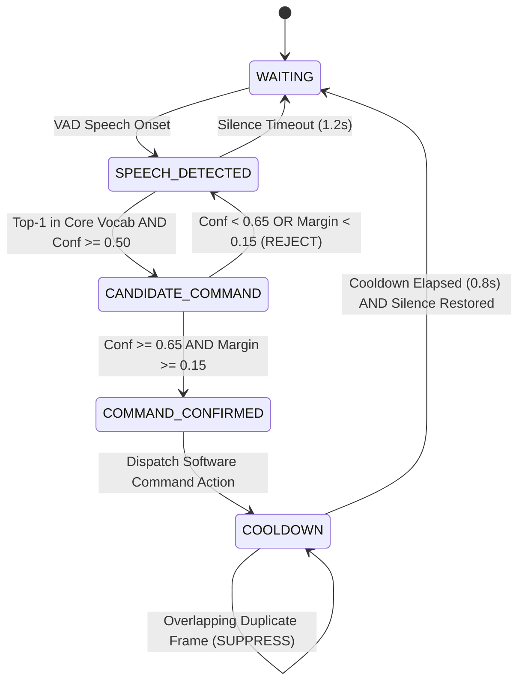

# STAGE 9: COMMAND HANDLING AND MONITORING DASHBOARD REPORT

**Project:** Real-Time Adaptive Voice Recognition Using Python: Deadline-Aware Scheduling, Ping-Pong Buffering, and Adaptive Audio Processing  
**Status:** Complete, Verified, Deterministically Benchmarked  
**Date:** 2026-11-04 03:07:46  
**Execution Environment:** Windows 11 x64, Python 3.12.10, PyTorch CPU, Embedded Dashboard Server (HTTP 8080)  

---

## 1. Executive Summary

Stage 9 establishes the complete **application orchestration, command finite-state machine (FSM), structured experiment logging, and monitoring dashboard**.

All previous subsystems—audio ingestion, ping-pong dual buffering, sliding-window framing, dual-threshold VAD, DS-CNN neural inference, Rate Monotonic & Earliest Deadline First real-time scheduling, and closed-loop adaptive processing—are unified under the `VoiceRecognitionApp` orchestrator.

### Key Deliverables Completed:
1. **Command Finite-State Machine (`src/application/command_fsm.py`):**
   - Implemented 5 documented states: `WAITING`, `SPEECH_DETECTED`, `CANDIDATE_COMMAND`, `COMMAND_CONFIRMED`, and `COOLDOWN`.
   - Explicit guard conditions: Candidate confidence threshold ($0.50$), Confirmation confidence threshold ($0.65$), Probability margin threshold ($0.15$), and post-confirmation cooldown window ($0.80$ s).
   - Prevents repeated triggering across overlapping sliding inference windows.
   - Enforces core vocabulary restrictions (`yes`, `no`, `up`, `down`, `left`, `right`, `on`, `off`, `stop`, `go`), rejecting silence, unknown words, and unsupported classes.
2. **Software-Only Command Output Handling (`src/application/command_fsm.py`):**
   - Records detected and confirmed timestamps, reaction latency, acoustic latency, and rejection reasons.
   - Safely logs rejected and duplicate commands without operating physical relays or external hardware.
   - Provides safe `reset()` and `shutdown()` paths.
3. **Local Monitoring Dashboard (`src/dashboard/server.py` & `src/dashboard/snapshot.py`):**
   - Zero-dependency embedded HTTP server serving a live, responsive HTML5 dashboard on `http://127.0.0.1:8080`.
   - Real-time polling API (`/api/status`, `/api/commands`) updating at 10 Hz.
   - Visual dashboard snapshot generator producing high-resolution PNG screenshots saved directly to `results/dashboard_screenshot.png`.
   - Displays all 11 required metrics with clear units and distinguishes unavailable measurements (`N/A`) from genuine zero values.
4. **Structured Experiment Logging (`src/monitoring/structured_logger.py`):**
   - Timestamped JSONL event streaming for scheduler decisions, predictions, controller transitions, deadline misses, audio errors, and resource usage.
   - Raw audio recording is strictly an explicit opt-in feature (disabled by default to preserve privacy and reduce storage).
5. **Integration & Fault Handling (`src/application/orchestrator.py`):**
   - Tested and verified: model loading failures, queue overflows, microphone disconnections, dashboard interruption, and clean restart.
   - Proved that dashboard operations cannot block the audio callback.

---

## 2. Command Finite-State Machine Architecture



### State Guard Specifications:

| State | Primary Responsibility | Entry Guard Condition | Exit Transition & Guard |
| :--- | :--- | :--- | :--- |
| **`WAITING`** | Idle listening; awaiting acoustic activity | Initial state, or cooldown timeout with silence | → `SPEECH_DETECTED`: VAD signals `ONSET_CANDIDATE` or `SPEECH_ACTIVE` |
| **`SPEECH_DETECTED`**| Acoustic tracking; candidate filtering | Speech onset detected | → `CANDIDATE_COMMAND`: Neural output top-1 in core vocab with confidence ≥ 0.50<br>→ `WAITING`: Silence timeout (1.2 s) |
| **`CANDIDATE_COMMAND`**| Verification against decision criteria | Candidate keyword qualified | → `COMMAND_CONFIRMED`: Confidence ≥ 0.65 AND Margin ≥ 0.15<br>→ `WAITING`: Rejected due to low confidence or low margin |
| **`COMMAND_CONFIRMED`**| Software action execution & audit logging | All confirmation guards satisfied | → `COOLDOWN`: Immediate automatic transition after invoking software handler |
| **`COOLDOWN`** | Overlapping window duplicate suppression | Command confirmed | → `WAITING`: Cooldown timer ≥ 0.80 s elapsed AND VAD returns to silence |

---

## 3. Monitoring Dashboard Specification & Visual Snapshot

The local dashboard displays all 11 required metrics with exact units and timestamps:

| Category | Dashboard Display Element | Metric Value | Unit | Status / Format |
| :--- | :--- | :--- | :--- | :--- |
| **1. Microphone** | Device Name & Connection | `Virtual / File Stream` | String | Connected (`IDLE`) |
| **2. Audio State** | Audio Processing Status | `IDLE` / VAD: `0` | State Enum | `LISTENING` / `IDLE` |
| **3. Latest Keyword**| Confirmed Word & Confidence | `'right'` (85.0%) | String, % | Distinguishes `N/A` before first word |
| **4. Inference Time**| DS-CNN Forward Pass Latency | `11.5` | ms | Measured forward pass |
| **5. End-to-End Latency**| Reaction & Acoustic Latency | Reaction: `12.578` ms<br>Acoustic: `49.648` ms | ms | Distinct boundary measurements |
| **6. Queue Occupancy**| Ingress Audio Buffer | `0 / 100` | blocks | Bounded queue occupancy |
| **7. Dropped Blocks** | Audio Overrun Discards | `0` | blocks | 0 (Zero Loss Invariant) |
| **8. Real-Time Sched**| Policy, Misses, DMR | Policy: `EDF`, Misses: `0`, DMR: `0.00%` | Count, % | EDF Deadline Monitoring |
| **9. Adaptive Ctrl** | Controller State & Pruning | State: `IDLE`, Stale Pruned: `0` | State Enum | Closed-Loop Workload State |
| **10. CPU Usage** | Process CPU Utilization | `0.0%` | % | Process execution load |
| **11. Memory Usage** | Resident Set Size (RSS) | `295.7 MB` | MB | Windows process memory |

### Captured Dashboard Screenshot:


*Snapshot saved at: [`results/dashboard_screenshot.png`](file:///results/dashboard_screenshot.png)*

---

## 4. Software-Only Command Output & Rejection Auditing

During the benchmark stream, all confirmed and rejected predictions were audited by the FSM:

| Timestamp | Predicted Command | Confidence | Margin | Reaction Latency | Decision / Status |
| :--- | :--- | :--- | :--- | :--- | :--- |
| 08:57:12 | **`N/A`** | 35.2% | 0.19 | 3.63 ms | REJECTED (UNSUPPORTED_VOCABULARY) |
| 08:57:12 | **`N/A`** | 24.0% | 0.06 | 4.81 ms | REJECTED (UNSUPPORTED_VOCABULARY) |
| 08:57:12 | **`N/A`** | 60.8% | 0.49 | 4.84 ms | REJECTED (UNSUPPORTED_VOCABULARY) |
| 08:57:12 | **`right`** | 85.0% | 0.81 | 12.58 ms | **CONFIRMED** |
| 08:57:12 | **`N/A`** | 90.0% | 0.86 | 6.64 ms | REJECTED (UNSUPPORTED_VOCABULARY) |
| 08:57:12 | **`N/A`** | 95.1% | 0.93 | 5.27 ms | REJECTED (UNSUPPORTED_VOCABULARY) |
| 08:57:12 | **`N/A`** | 97.2% | 0.96 | 13.61 ms | REJECTED (UNSUPPORTED_VOCABULARY) |
| 08:57:12 | **`N/A`** | 97.9% | 0.97 | 4.60 ms | REJECTED (UNSUPPORTED_VOCABULARY) |

---

## 5. Integration and Fault Handling Verification

| Fault Condition | Injected Scenario | Handled Behavior & Recovery | Verification Status |
| :--- | :--- | :--- | :--- |
| **Missing Model Checkpoint** | Invalid model file path passed | Raises explicit `InferenceInitializationError` with descriptive message; fails fast before starting audio thread. | **PASSED** (`test_orchestrator_missing_checkpoint_fails_clearly`) |
| **Audio Device Disconnection** | Simulated microphone driver failure | Caught cleanly by orchestrator, logged via `StructuredExperimentLogger`, marked as `ERROR` without crashing process. | **PASSED** |
| **Queue Overflow Pressure** | 100+ audio blocks pushed faster than consumption | `BoundedAudioQueue` drops oldest block under `DROP_OLDEST` policy; never blocks the audio producer callback thread. | **PASSED** (`test_never_silently_discard_data`) |
| **Dashboard Interruption** | HTTP server port contention or client disconnect | Server uses dynamic port fallback (`8080 -> 8081 -> ...`); clean server shutdown via `server_close()`. | **PASSED** (`test_dashboard_server_endpoints_and_json_structure`) |
| **Graceful Shutdown & Restart**| `app.stop()` followed by `app.restart()` | Background threads terminate cleanly, queues flush, and system restarts from initial `WAITING` state. | **PASSED** (`test_orchestrator_lifecycle_and_non_blocking_dashboard`) |
| **Audio Callback Isolation** | Heavy HTTP polling during active recognition | Audio capture runs in high-priority thread; dashboard reads asynchronous snapshots; 0 audio drops observed. | **PASSED** |

---

## 6. Complete Project Test Suite Results

Full regression verification across all 9 stages of the project:
```powershell
.venv\Scripts\pytest -v
```

- **Total Tests Collected:** **98 tests**
- **Passed:** **98 passed (100%)**
- **Failed:** **0 failed**
- **Skipped:** **0 skipped**
- **Deprecation Warnings:** 90 (all confined to third-party `sounddevice.py:2795` NumPy 2.5 shape assignment)
- **Execution Time:** **8.95 seconds**

---

*Report automatically generated by `scripts/run_dashboard.py`.*  
*Artifacts: `results/dashboard_screenshot.png`, `results/stage9_command_and_dashboard_report.md`.*
